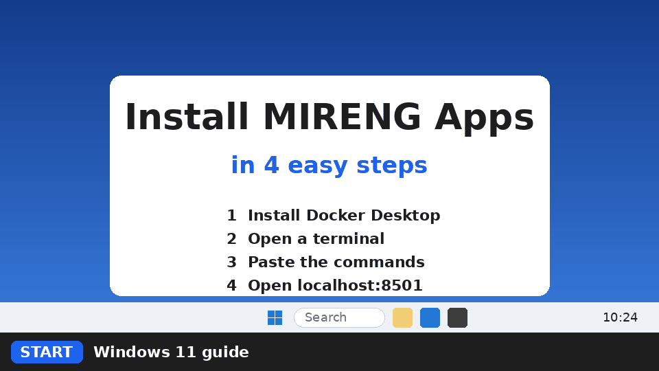

# MIRENG Apps - Installation guide



The following instructions will guide you through installing and running Mireng Apps (https://mireng.ai/) using Docker.

## Overview

This guide will:

- Make a folder mireng-apps-main in your home folder.
- Download the AI Apps repository as a tarball, extract it into the folder and delete the tarball. 
- A second download overwrites files but does not remove obsolete files.
- Build the production Docker image.
- Pull the `nginx-unprivileged` image.
- Create the model's volume.
- Download a Hugging Face model.
- Download the llama cpp server image.
- Compose and run the container.

> Docker automatically creates `mireng-apps-projects` if missing and mounts it at `/app/my-projects`.

Your project files will be in:

- Windows: `C:\Users\<user>\mireng-apps-projects`
- macOS: `/Users/<user>/mireng-apps-projects`
- Linux: `/home/<user>/mireng-apps-projects`.
    - `mireng-apps-projects` must be writable by UID 1000. Before starting the installation, create `~/mireng-apps-projects` and ensure UID 1000 has write permission.

---
> By installing and using MIRENG Apps, you agree to the End User License Agreement (EULA): https://mireng.ai/legal/eula/
---

## Download and Install Docker Desktop

https://www.docker.com/products/docker-desktop/

> **Secure Docker Desktop**: Go to `Settings > Resources > Network > Port binding behavior` and ensure it is set to `Localhost only`! 


## All commands instructions

### Windows

Open a Command Prompt (type `cmd` in the Start menu and press Enter).


```cmd
cd %USERPROFILE%
curl -fL -o mireng-apps.tar.gz https://github.com/nbakas/mireng-apps/archive/refs/heads/main.tar.gz
tar -xzf mireng-apps.tar.gz
del mireng-apps.tar.gz
cd mireng-apps-main
docker build --pull --no-cache -f Dockerfile.prod -t mireng-apps-prod-image .
docker pull nginxinc/nginx-unprivileged:stable-alpine-slim
docker volume create hf-cache
docker run --rm -t -v "hf-cache:/home/appuser/.cache/huggingface" mireng-apps-prod-image hf download unsloth/Qwen3.5-0.8B-GGUF Qwen3.5-0.8B-Q4_K_M.gguf mmproj-F16.gguf --revision 6ab461498e2023f6e3c1baea90a8f0fe38ab64d0
docker pull ghcr.io/ggml-org/llama.cpp:server
docker compose -f docker-compose-prod.yaml up -d
```

### Linux / macOS

Open a terminal (Linux: `Ctrl+Alt+T`, macOS: `Cmd+Space`, type Terminal, press Enter).

```
cd ~
curl -fL -o mireng-apps.tar.gz https://github.com/nbakas/mireng-apps/archive/refs/heads/main.tar.gz
tar -xzf mireng-apps.tar.gz
rm mireng-apps.tar.gz
cd mireng-apps-main
docker build --platform linux/amd64 --pull --no-cache -f Dockerfile.prod -t mireng-apps-prod-image .
docker pull nginxinc/nginx-unprivileged:stable-alpine-slim
docker volume create hf-cache
docker run --rm -t --platform linux/amd64 -v "hf-cache:/home/appuser/.cache/huggingface" mireng-apps-prod-image hf download unsloth/Qwen3.5-0.8B-GGUF Qwen3.5-0.8B-Q4_K_M.gguf mmproj-F16.gguf --revision 6ab461498e2023f6e3c1baea90a8f0fe38ab64d0
docker pull ghcr.io/ggml-org/llama.cpp:server
docker compose -f docker-compose-prod.yaml up -d
```

## Browser

The application should now be running in the Docker container.

Open http://localhost:8501 in your web browser.

## Stop and restart the container

Docker Desktop UI:

- To stop the container, go to Containers, click the stop button.
- To restart the container, click the start button.

Stop/restart the whole stack named `mireng-apps-prod-container`, not one nested container.

Terminal:

- To stop the container:

```
docker compose -f docker-compose-prod.yaml stop
```

- To restart the container:

```
docker compose -f docker-compose-prod.yaml restart
```

## Download other LLMs

For unsloth/gemma-4-E4B-it use the following command:

```
docker run --rm -t -v "hf-cache:/home/appuser/.cache/huggingface" mireng-apps-prod-image hf download unsloth/gemma-4-E4B-it-GGUF gemma-4-E4B-it-Q4_K_M.gguf mmproj-F16.gguf --revision bfc15c382204943c3a8fff0c750b94ae2364d7a3
```

For unsloth/gemma-4-E2B-it use the following command:

```
docker run --rm -t -v "hf-cache:/home/appuser/.cache/huggingface" mireng-apps-prod-image hf download unsloth/gemma-4-E2B-it-GGUF gemma-4-E2B-it-Q4_K_M.gguf mmproj-F16.gguf --revision 0314792d7f1f7e229411f620751375812bb9faf2
```
> Also, uncomment the corresponding line in `docker-compose-prod.yaml` for model and mmproj to enable the downloaded model, and comment out the Qwen model.

You can download any other Hugging Face model accordingly.
